# Tâche 3 – IFT3913

## Partie 1 – Modification du workflow GitHub Actions avec Semgrep

### 1. Objectif

Le workflow `.github/workflows/main-jdk17-build.yml` de Tika a été modifié pour que le build Maven ne se lance pas lorsqu'un changement introduit une nouvelle alerte détectée par Semgrep. Une alerte est nouvelle si elle n'existe pas dans un commit de référence : les alertes déjà présentes dans Tika ne bloquent donc pas le build.

### 2. Choix de conception et d'implémentation

Le fichier contenait déjà un job `semgrep` avec les règles Java `p/java`. Le job `build` a reçu `needs: semgrep`, ce qui rend son démarrage dépendant de la réussite de l'analyse.

Choix de conception : `build` dépend de semgrep pour échouer rapidement et économiser des minutes. Le scan prend environ 30 secondes, alors que le build Maven complet en prend presque 40. Si `semgrep` échoue, `build` est ignoré, ainsi que `e2e-tests`, qui dépend du build.

La commande Semgrep utilise `--baseline-commit "$BASE_SHA"` pour trouver les alertes nouvelles. Pour une pull request, `BASE_SHA` est le SHA de la branche cible. Pour un push sur `main`, c'est le SHA de `main` juste avant le push, ce qui couvre aussi un push de plusieurs commits. Le checkout utilise `fetch-depth: 0` pour que Semgrep ait l'historique Git nécessaire, et `--error` fait renvoyer un code de sortie non nul à Semgrep lorsqu'il trouve une nouvelle alerte.

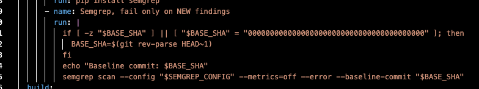

### 3. Validation sur GitHub Actions

**Sans nouvelle alerte.** Sur un push vers `main` (exécution nº 4), le job `semgrep` a réussi en 34 secondes, puis l'étape `Build with Maven` a démarré.

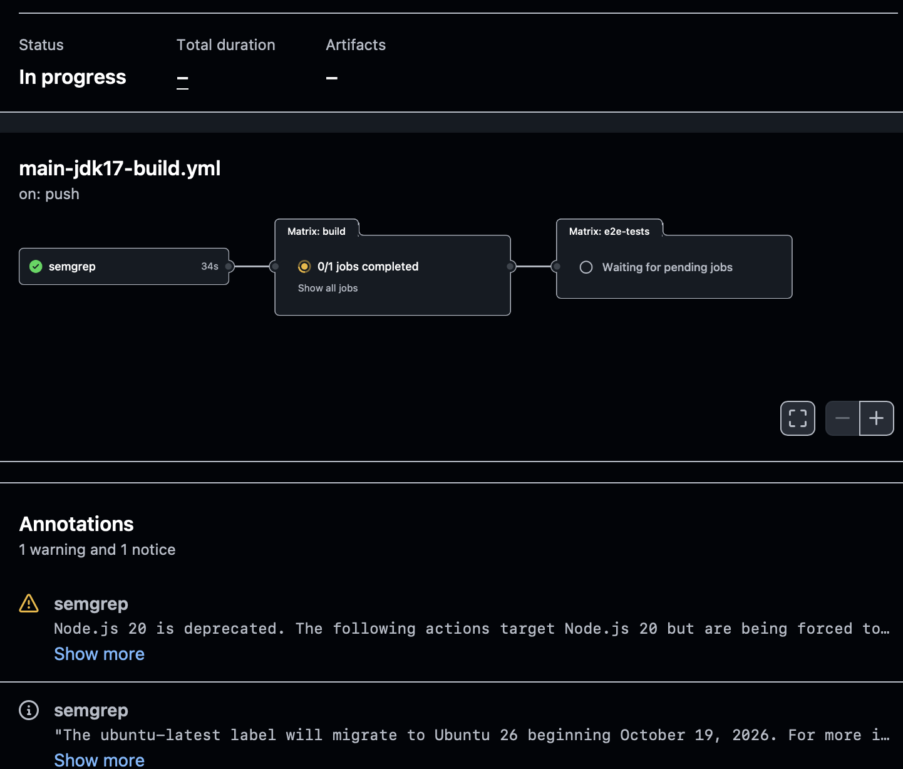

**Avec une alerte contrôlée.** La pull request nº 2, de `validation-semgrep` vers `main`, a ajouté temporairement une règle personnalisée (`validation-semgrep-ci`) qui cherche le marqueur `SEMGREP_CI_VALIDATION` dans un fichier Java. Semgrep l'a détecté à la ligne 2 de `SemgrepValidation.java`, absent du commit de référence, et a renvoyé le code de sortie `1`. Le job `semgrep` est en échec et `build` et `e2e-tests` sont ignorés : le blocage intervient avant Maven. Cette PR n'a pas été mergée dans `main`.

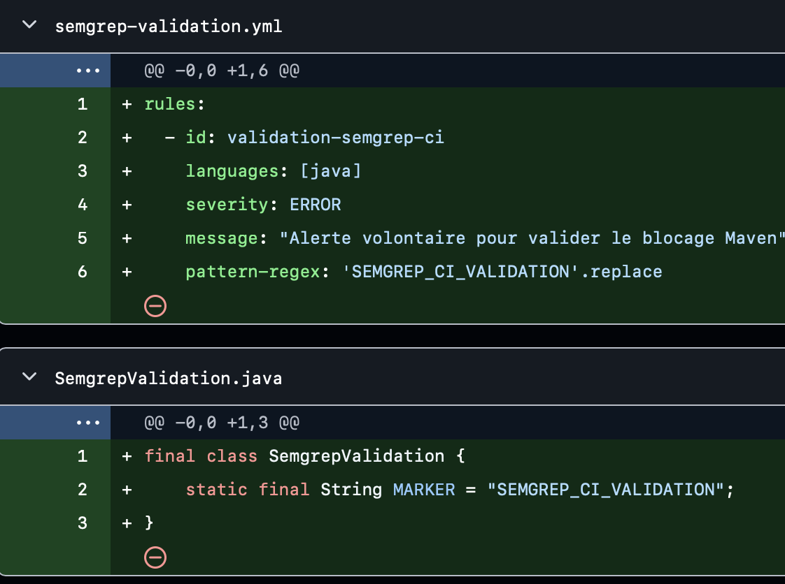

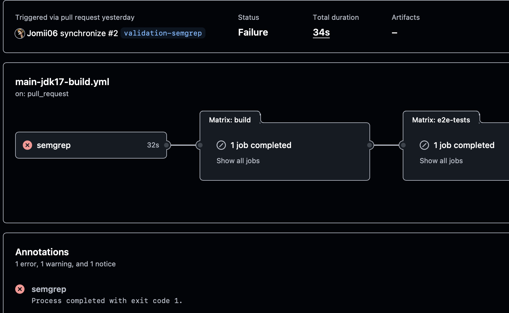

**Avec les vraies vulnérabilités.** La pull request avec les 7 vulnérabilités de la partie 2 donne le même résultat. Après le merge dans `main`, le push fait aussi échouer `semgrep`.

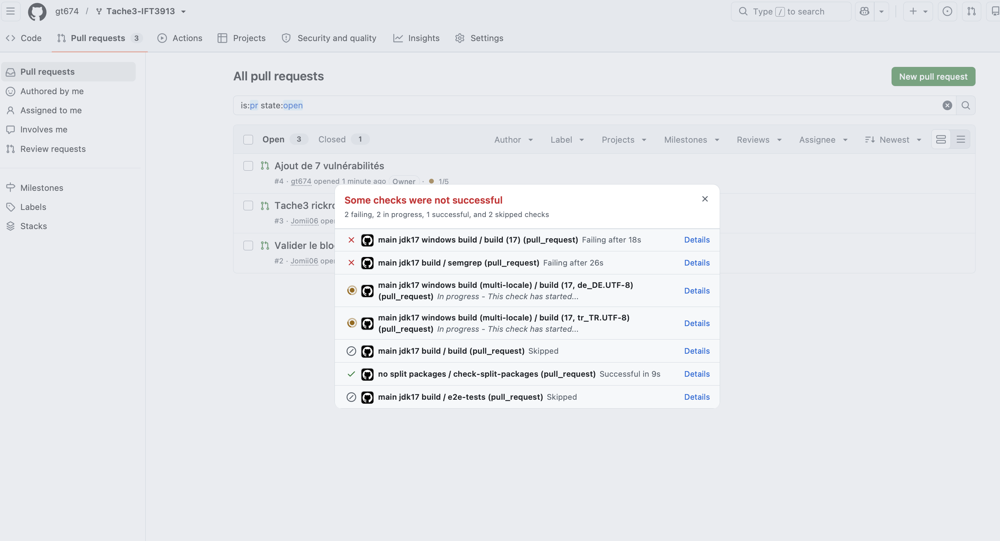

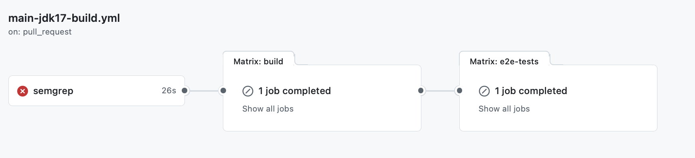

## Partie 2 – Sept types de vulnérabilités détectées par Semgrep

### 1. Choix des fichiers et des cas

Les 7 vulnérabilités sont dans `tika-core`, l'un des modules permis, chacune dans une méthode séparée et dans son propre commit. Trois conditions ont guidé le choix : un type de vulnérabilité différent des autres, une règle `p/java` différente pour la détecter, et du code qui a du sens dans le fichier où il est placé. Les cas viennent de catégories classiques : cryptographie, communications non chiffrées, injection et mauvaise configuration XML. Les trois cas de cryptographie (MD5, AES/ECB, RC4) sont séparés parce qu'ils visent trois faiblesses différentes (hachage, mode de chiffrement, algorithme) et qu'ils sont signalés par trois règles différentes.

Quatre fichiers sont touchés, chacun choisi parce que sa classe fait déjà un travail lié à la vulnérabilité : calcul d'empreintes, chiffrement, ouverture de flux et lecture de XML.

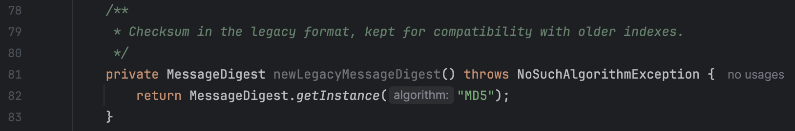

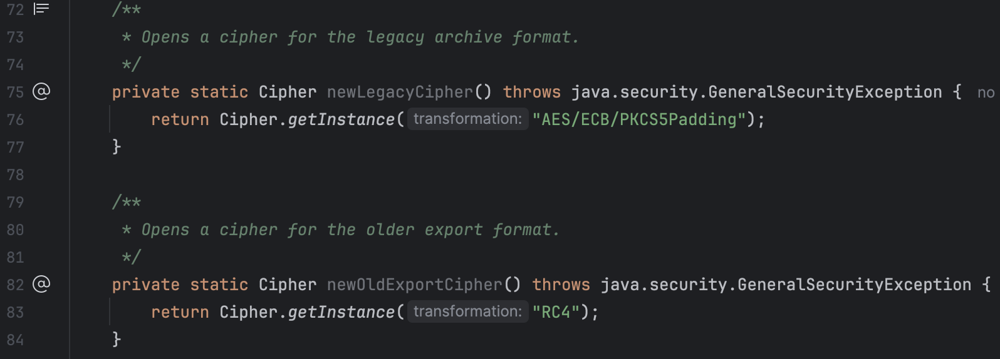

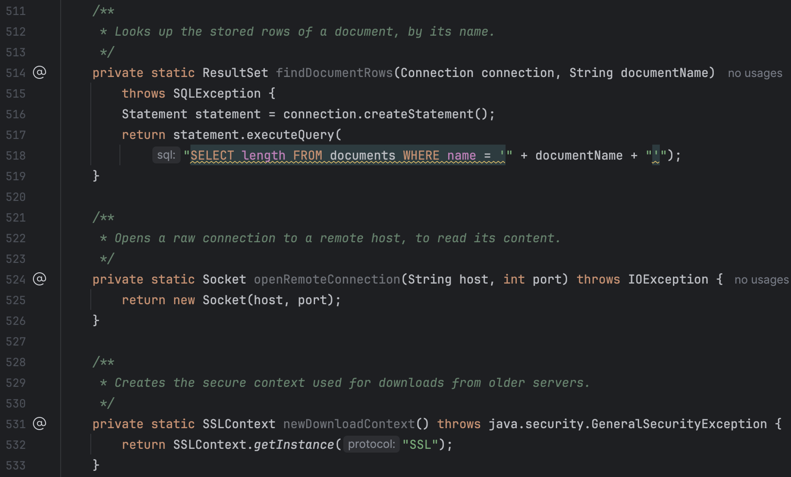

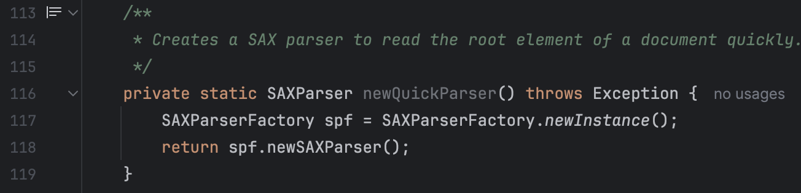

### 2. Justification des sept cas et résultats de Semgrep

**1. MD5 – `InputStreamDigester.java`.** Fichier choisi : la classe calcule déjà des empreintes de flux. Méthode `newLegacyMessageDigest`. Type : algorithme de hachage cassé. MD5 a des collisions connues, donc il ne peut pas servir à vérifier l'intégrité. Semgrep la trouve à la ligne 82. Règle : `java.lang.security.audit.crypto.use-of-md5.use-of-md5`

**2. AES/ECB – `CryptoParser.java`.** Fichier choisi : la classe gère déjà le chiffrement avec `Cipher`. Méthode `newLegacyCipher`, `AES/ECB/PKCS5Padding`. Type : mode de chiffrement non sécuritaire. ECB chiffre les blocs identiques de la même façon, ce qui laisse voir des motifs dans les données. Ligne 76. Règle : `java.lang.security.audit.crypto.use-of-aes-ecb.use-of-aes-ecb`

**3. RC4 – `CryptoParser.java`.** Même fichier que la 2, pour la même raison. Méthode `newOldExportCipher`. Type : algorithme de chiffrement faible. RC4 est considéré comme cassé. Ligne 83. Règle : `java.lang.security.audit.crypto.use-of-rc4.use-of-rc4`

**4. Injection SQL – `TikaInputStream.java`.** Fichier choisi : la classe ouvre des flux depuis plusieurs sources, donc un accès à une base de données ou au réseau y est plausible (même raison pour les vulnérabilités 5 et 6). Méthode `findDocumentRows`. Type : injection. La requête est construite en concaténant un paramètre, donc du SQL peut y être inséré. Un `PreparedStatement` serait nécessaire. Lignes 517-518. Règle : `java.lang.security.audit.formatted-sql-string.formatted-sql-string`

**5. Socket non chiffré – `TikaInputStream.java`.** Méthode `openRemoteConnection`. Type : transport en clair. Un `Socket` normal envoie tout sans chiffrement, donc les données peuvent être lues ou modifiées sur le réseau. Ligne 525. Règle : `java.lang.security.audit.crypto.unencrypted-socket.unencrypted-socket`

**6. SSLContext "SSL" – `TikaInputStream.java`.** Méthode `newDownloadContext`. Type : protocole obsolète. `"SSL"` peut donner de vieilles versions du protocole qui ont des failles, alors qu'il faudrait demander `TLSv1.2` ou `TLSv1.3`. Ligne 532. Règle : `java.lang.security.audit.weak-ssl-context.weak-ssl-context`

**7. XXE – `XmlRootExtractor.java`.** Fichier choisi : la classe fait déjà du parsing XML. Méthode `newQuickParser`. Type : entités XML externes. Le `SAXParserFactory` n'est pas configuré pour désactiver les DTD externes, donc un XML malicieux pourrait faire lire des fichiers du serveur. Ligne 118. Règle : `java.lang.security.audit.xxe.saxparserfactory-disallow-doctype-decl-missing.saxparserfactory-disallow-doctype-decl-missing`

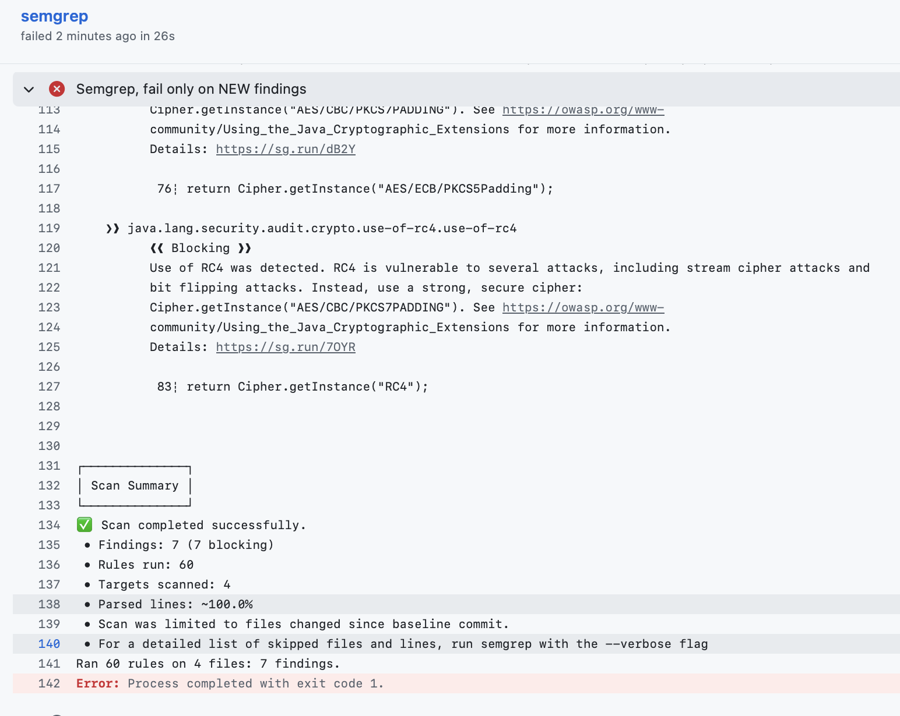

## Partie 3 – Comparaison des rapports Semgrep avant et après

La même commande Semgrep (`p/java`) a été lancée avant et après les changements, et les deux fichiers JSON ont été gardés : [semgrep-avant.json](docs/tache3/semgrep-avant.json) et [semgrep-apres.json](docs/tache3/semgrep-apres.json).

Avant, il y avait 11 trouvailles. Après, il y en a 18 : 7 nouvelles et 0 qui ont disparu, donc exactement les 7 vulnérabilités de la partie 2. Les 11 anciennes sont identiques dans les deux rapports, et les 7 nouvelles sont identifiées par leur fichier et leur ligne dans `semgrep-apres.json`.

## Partie 4 – Rickroll quand un test échoue

Une action composite maison se trouve dans `.github/actions/rickroll/action.yml`. Une implémentation propre a été préférée à `random-rickroll`, qui est ancienne (node12) et demanderait de lui confier le token du dépôt. Elle est appelée dans le job `build` après « Build with Maven », avec `if: failure()`.

Elle écrit d'abord le rickroll dans le résumé du run (`$GITHUB_STEP_SUMMARY`), ce qui marche toujours. Ensuite, si c'est une PR, elle poste un commentaire avec `gh pr comment`; cette partie est en `continue-on-error`, donc un problème de commentaire ne change pas le résultat du workflow.

Preuve : sur une PR, le build a échoué (un test d'intégration S3 de Tika sans lien avec le code modifié, ce qui a servi de vrai échec) et le rickroll s'est affiché dans un commentaire de la PR et dans le résumé du run.

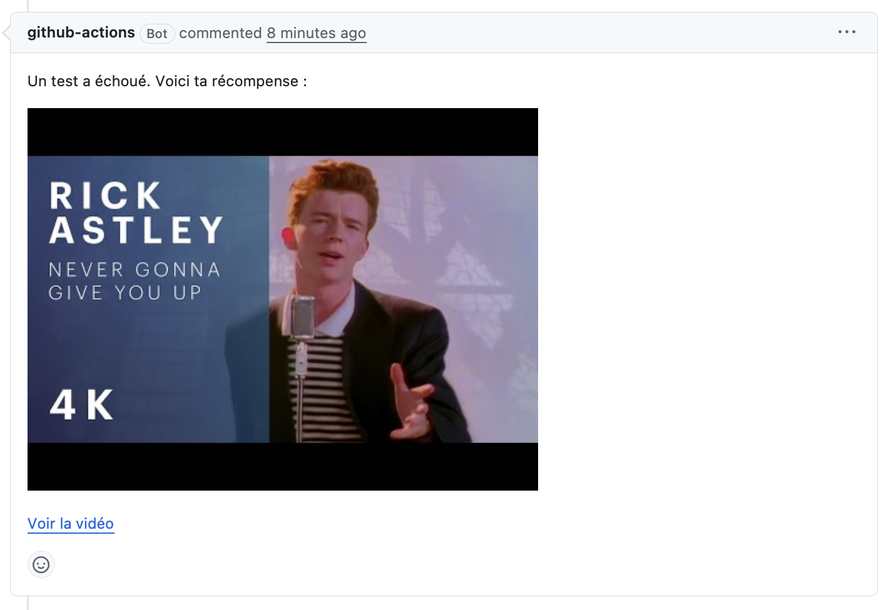

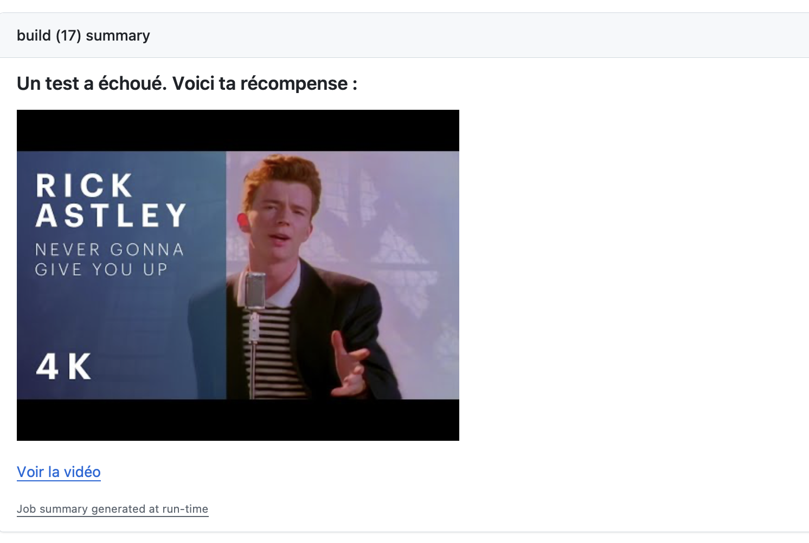

Limite : l'action se déclenche pour n'importe quelle erreur du build, pas seulement pour un test qui échoue (par exemple le check RAT ou le javadoc).

## Déclaration d'utilisation de l'IA

Claude (Anthropic, 2026) a servi à comprendre Semgrep et GitHub Actions, à trouver des idées de vulnérabilités et à déboguer des commandes.
Les modifications ont été appliquées et testées dans le dépôt, et les résultats ont été vérifiés dans Semgrep et GitHub.

Anthropic. (2026). *Claude* (Sonnet 5.5) [Modèle de langage]. https://claude.ai
