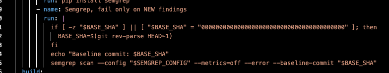
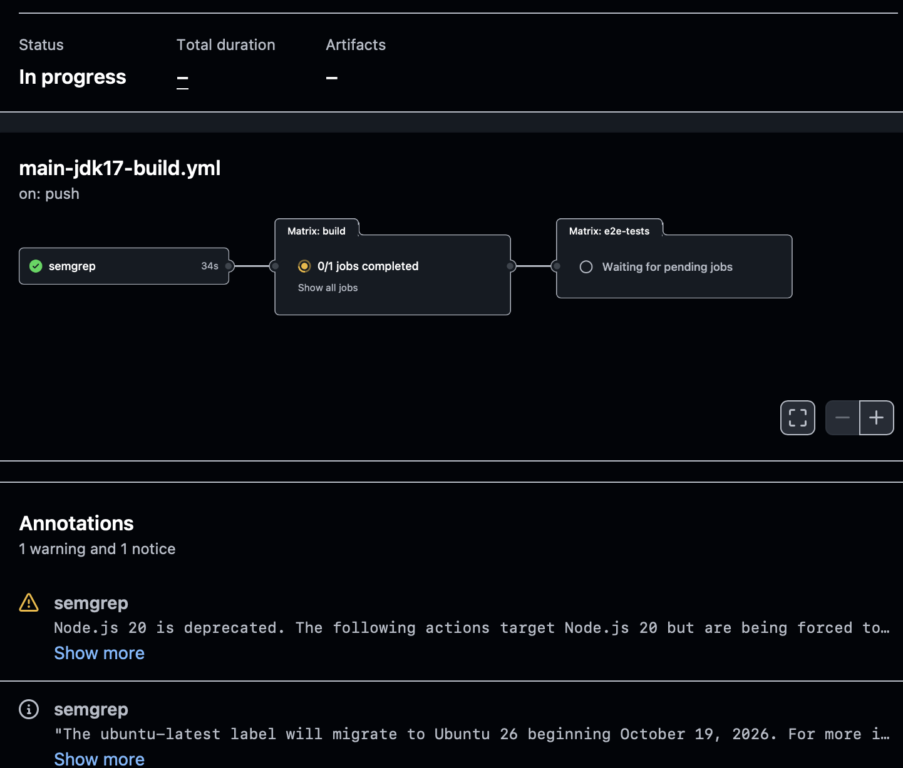
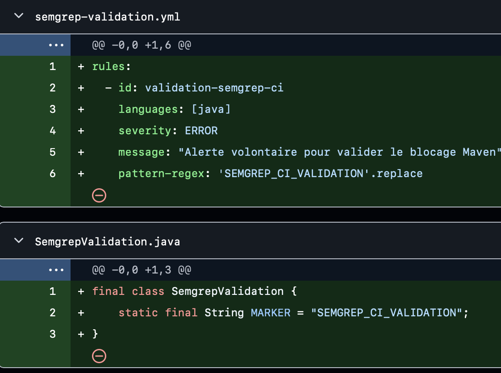
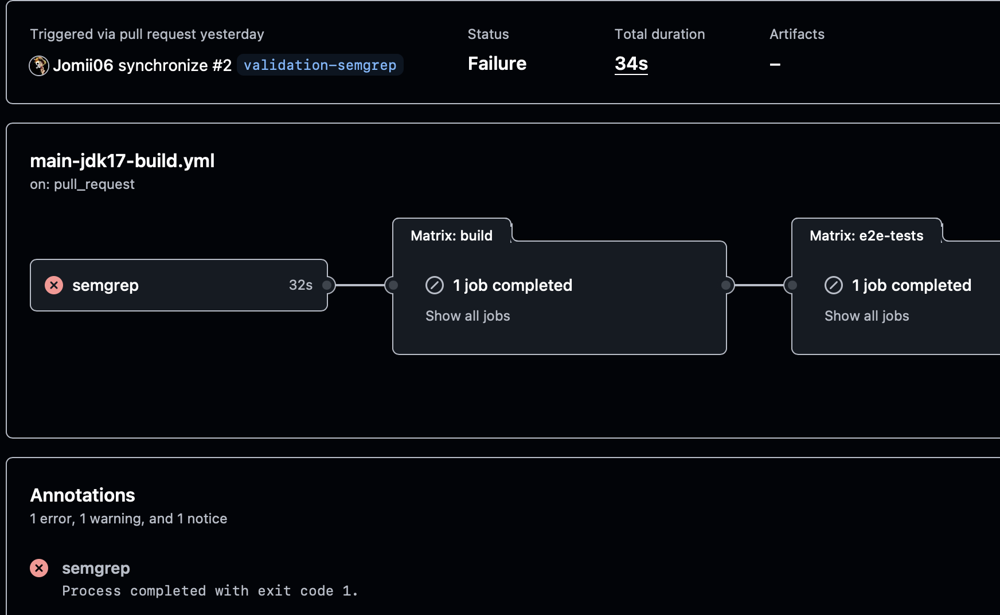

# Tâche 3 – IFT3913
## — Modification du workflow GitHub Actions avec Semgrep

### 1. Objectif

Nous avons modifié le workflow GitHub Actions d’Apache Tika pour empêcher le lancement du build Maven lorsqu’un changement introduit une nouvelle alerte détectée par Semgrep. Pour déterminer si une alerte est nouvelle, Semgrep compare le code analysé à un commit de référence. Les alertes déjà présentes dans cette référence ne bloquent pas le build à elles seules.

### 2. Choix de conception et d’implémentation

#### 2.1. Exécuter Semgrep avant le build Maven

Le fichier `.github/workflows/main-jdk17-build.yml` contenait déjà un job `semgrep` qui utilisait le jeu de règles Java `p/java`. Nous avons ajouté `needs: semgrep` au job `build` pour rendre son démarrage dépendant de la réussite de l’analyse.

```yaml
build:
  needs: semgrep
  runs-on: ubuntu-latest
  timeout-minutes: 60
```

Si le job `semgrep` réussit, GitHub Actions peut lancer le build Maven. Si le job échoue, l’exécution du workflow se termine en échec et GitHub Actions ignore le job `build`. Le job `e2e-tests`, qui dépend du build, est également ignoré.
#### 2.2. Comparer les alertes à un commit de référence

La commande Semgrep utilise l’option `--baseline-commit "$BASE_SHA"` pour identifier les alertes nouvelles par rapport à un état de référence. Le choix de `BASE_SHA` dépend de l’événement qui déclenche le workflow.

| Événement GitHub Actions | Commit de référence | Justification |
| --- | --- | --- |
| Pull request | SHA de la branche cible fourni par l’événement | Évaluer les changements proposés par la pull request par rapport à la branche cible. |
| Push sur `main` | SHA de `main` immédiatement avant le push | Évaluer les changements apportés par le push, qui peut contenir plusieurs commits. |

L’étape de récupération du dépôt utilise `fetch-depth: 0` pour donner à Semgrep accès à l’historique Git nécessaire à la comparaison. L’option `--error` permet à Semgrep de renvoyer un code de sortie non nul lorsqu’il relève une nouvelle alerte. GitHub Actions marque alors le job `semgrep` en échec et applique la dépendance définie sur le job `build`.




### 3. Validation sur GitHub Actions

#### 3.1. Scénario sans nouvelle alerte

Nous avons vérifié le comportement du workflow sur un push vers `main`. Dans l’exécution nº 4 de `main jdk17 build`, le job `semgrep` a réussi en 34 secondes. L’étape `Build with Maven` a ensuite démarré. Cette exécution confirme que la réussite du scan permet au build de se lancer.




#### 3.2. Scénario avec une nouvelle alerte bloquante

Pour valider le blocage, nous avons utilisé la pull request nº 2, de `validation-semgrep` vers `main`. Nous avons ajouté temporairement une règle personnalisée, `validation-semgrep-ci`, dans `semgrep-validation.yml`, en complément des règles `p/java`. Cette règle recherchait le marqueur de test `SEMGREP_CI_VALIDATION` dans un fichier Java.

Lors de la première exécution de cette pull request, Semgrep a détecté le marqueur à la ligne 2 de `SemgrepValidation.java`. Le fichier était absent du commit de référence. Semgrep a signalé une alerte bloquante et a renvoyé le code de sortie `1`. Ce marqueur contrôlé servait à vérifier que la CI réagit au signalement d’une nouvelle alerte.




Dans le résumé de cette même exécution, GitHub Actions a affiché le job `semgrep` en échec et les jobs `build` et `e2e-tests` comme ignorés. Le blocage est donc intervenu avant le lancement de Maven.

## — Simulation de sept types de vulnérabilités et détection par Semgrep

### 1. Choix des fichiers modifiés

<!-- TODO —   Gabrielle  -->


Nous avons regroupé les sept cas dans `SemgrepValidation.java`, le fichier Java déjà utilisé pour valider le blocage du workflow dans la partie 1. Ce choix permet de reprendre le marqueur initial comme témoin et d’attribuer chaque nouvelle alerte à une ligne distincte du même fichier.

Pour chaque cas, nous avons ajouté une constante Java contenant un marqueur et une règle correspondante dans `semgrep-validation.yml`. Chaque règle recherche la chaîne littérale associée à son cas. Le scan combine ces règles personnalisées avec le jeu de règles `p/java`.


### 2. Justification des sept cas et résultats de Semgrep

<!-- TODO —   Gabrielle - Bien  documenter , expliquer et justifier le choix de cas insérée  -->

Elles sont toutes dans `tika-core`, une par commit, dans des méthodes ajoutées exprès. Chaque fichier a été choisi parce qu'il touche déjà au domaine de la vulnérabilité, ce qui rend le code ajouté réaliste.

**1. MD5 – `InputStreamDigester.java`.** Fichier choisi : la classe calcule déjà des empreintes de flux. Méthode `newLegacyMessageDigest`. Type : algorithme de hachage cassé. MD5 a des collisions connues, donc il ne peut pas servir à vérifier l'intégrité. Semgrep la trouve à la ligne 82. Règle : `java.lang.security.audit.crypto.use-of-md5.use-of-md5`

**2. AES/ECB – `CryptoParser.java`.** Fichier choisi : la classe gère déjà le chiffrement avec `Cipher`. Méthode `newLegacyCipher`, `AES/ECB/PKCS5Padding`. Type : mode de chiffrement non sécuritaire. ECB chiffre les blocs identiques de la même façon, ce qui laisse voir des motifs dans les données. Ligne 76. Règle : `java.lang.security.audit.crypto.use-of-aes-ecb.use-of-aes-ecb`

**3. RC4 – `CryptoParser.java`.** Même fichier que la 2, pour la même raison. Méthode `newOldExportCipher`. Type : algorithme de chiffrement faible. RC4 est considéré comme cassé. Ligne 83. Règle : `java.lang.security.audit.crypto.use-of-rc4.use-of-rc4`

**4. Injection SQL – `TikaInputStream.java`.** Fichier choisi : la classe ouvre des flux depuis plusieurs sources, donc un accès à une base de données ou au réseau y est plausible (même raison pour les vulnérabilités 5 et 6). Méthode `findDocumentRows`. Type : injection. La requête est construite en concaténant un paramètre, donc du SQL peut y être inséré. Un `PreparedStatement` serait nécessaire. Lignes 517-518. Règle : `java.lang.security.audit.formatted-sql-string.formatted-sql-string`

**5. Socket non chiffré – `TikaInputStream.java`.** Méthode `openRemoteConnection`. Type : transport en clair. Un `Socket` normal envoie tout sans chiffrement, donc les données peuvent être lues ou modifiées sur le réseau. Ligne 525. Règle : `java.lang.security.audit.crypto.unencrypted-socket.unencrypted-socket`

**6. SSLContext "SSL" – `TikaInputStream.java`.** Méthode `newDownloadContext`. Type : protocole obsolète. `"SSL"` peut donner de vieilles versions du protocole qui ont des failles, alors qu'il faudrait demander `TLSv1.2` ou `TLSv1.3`. Ligne 532. Règle : `java.lang.security.audit.weak-ssl-context.weak-ssl-context`

**7. XXE – `XmlRootExtractor.java`.** Fichier choisi : la classe fait déjà du parsing XML. Méthode `newQuickParser`. Type : entités XML externes. Le `SAXParserFactory` n'est pas configuré pour désactiver les DTD externes, donc un XML malicieux pourrait faire lire des fichiers du serveur. Ligne 118. Règle : `java.lang.security.audit.xxe.saxparserfactory-disallow-doctype-decl-missing.saxparserfactory-disallow-doctype-decl-missing`

<!-- TODO — Gabrielle Insérer le ou les extraits du journal de la deuxième exécution de la PR nº 2. Faire apparaître les identifiants des sept règles et leurs numéros de ligne. Si le journal est trop long pour une capture lisible, utiliser deux captures. -->

## 3. Comparaison des rapports Semgrep avant et après les modifications

<!-- TODO —   Gabrielle - Mettre les liens de photos  -->

La même commande Semgrep (`p/java`) a été lancée avant et après les changements, et les deux fichiers JSON ont été gardés : [semgrep-avant.json]() et [semgrep-apres.json]().

Avant, il y avait 11 trouvailles. Après, il y en a 18 : 7 nouvelles et 0 qui ont disparu, donc exactement les 7 vulnérabilités de la section 3. Les 11 anciennes sont identiques dans les deux rapports, et les 7 nouvelles sont identifiées par leur fichier et leur ligne dans [semgrep-apres.json]().


## - Validation du rickroll

###  Ajout d’un rickroll lorsqu’un test Maven échoue

Une action composite maison se trouve dans `.github/actions/rickroll/action.yml`. Une implémentation propre a été préférée à `random-rickroll`, qui est ancienne (node12) et demanderait de lui confier le token du dépôt. Elle est appelée dans le job `build` après « Build with Maven », avec `if: failure()`.

Elle écrit d'abord le rickroll dans le résumé du run (`$GITHUB_STEP_SUMMARY`), ce qui marche toujours. Ensuite, si c'est une PR, elle poste un commentaire avec `gh pr comment`; cette partie est en `continue-on-error`, donc un problème de commentaire ne change pas le résultat du workflow.

Preuve : sur une PR, le build a échoué (un test d'intégration S3 de Tika sans lien avec le code modifié, ce qui a servi de vrai échec) et le rickroll s'est affiché dans un commentaire de la PR et dans le résumé du run.


Limite : l'action se déclenche pour n'importe quelle erreur du build, pas seulement pour un test qui échoue (par exemple le check RAT ou le javadoc).

## Déclaration d'utilisation de l'IA

Claude (Anthropic, 2026) a servi à comprendre Semgrep et GitHub Actions, à trouver des idées de vulnérabilités et à déboguer des commandes.
Les modifications ont été appliquées et testées dans le dépôt, et les résultats ont été vérifiés dans Semgrep et GitHub.

Anthropic. (2026). *Claude* (Sonnet 5.5) [Modèle de langage]. https://claude.ai


